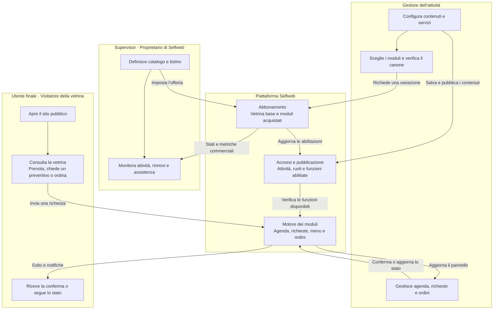

# Architettura logica di Selfweb

Selfweb offre una vetrina in abbonamento per ogni attività. Il gestore può aggiungere moduli operativi in base ai servizi che offre. La stessa piattaforma gestisce pubblicazione, utenti, abbonamenti e autorizzazioni per tutte le attività.

## Flusso tra i tre ruoli

## Ambito dei tre ruoli

- **Visitatore.** La vetrina base mostra servizi o prodotti, contatti e orari. Le azioni pubbliche dipendono dai moduli abilitati per quella vetrina. Il visitatore può ricevere e consultare l’esito della propria richiesta.
- **Gestore.** Il pannello riunisce contenuti, configurazione, richieste e risultati della propria attività. Il titolare gestisce canone e moduli. Gli operatori usano le funzioni operative previste dal loro ruolo.
- **Supervisor.** Il proprietario di Selfweb configura catalogo, prezzi e disponibilità dei moduli, segue lo stato di pubblicazione e degli abbonamenti e presidia il supporto. Le metriche di piattaforma includono adozione dei moduli, canone medio, permanenza dei clienti e carico di assistenza. Le schermate di monitoraggio usano dati aggregati dove possibile.

## Catalogo e dipendenze

| Modulo | Cosa fa il visitatore | Cosa gestisce l’attività | Punto di partenza |
| --- | --- | --- | --- |
| **Prenotazioni Pro** | Sceglie servizio, operatore e orario. Può spostare o annullare l’appuntamento secondo le regole definite. | Imposta durata, disponibilità e modalità di conferma. La conferma manuale è predefinita, quella automatica è facoltativa. | Evoluzione delle **Prenotazioni** già presenti. |
| **Preventivi & Sopralluoghi** | Invia una richiesta guidata con categoria, zona e foto facoltative. | Segue la richiesta fino al sopralluogo, al preventivo inviato e all’esito del lavoro. | Nuovo modulo. L’agenda può servire per fissare un sopralluogo. |
| **Promemoria & Lista d’attesa** | Riceve promemoria o un avviso quando si libera un posto. | Configura tempi, canale e quota di invio. | Estensione dell’agenda. Le conferme email rientrano in Prenotazioni Pro, SMS e WhatsApp sono opzioni con quota. |
| **Menu digitale** | Consulta menu, categorie e prezzi. | Aggiorna prodotti, prezzi e disponibilità. | Modulo già presente. Base operativa per l’asporto. |
| **Ordini da asporto** | Sceglie prodotti e fascia di ritiro, poi riceve l’esito dell’ordine. | Imposta capacità per fascia e pause, conferma e prepara le comande. | Estensione del Menu digitale. Prima versione per il ritiro in sede. |
| **Prenotazione tavoli** | Richiede un tavolo per giorno, orario e numero di persone. | Gestisce disponibilità, capienza e conferme del locale. | Variante dell’agenda per la ristorazione. |
| **Corsi & Campi** | Prenota un posto a lezione oppure una risorsa che usa in esclusiva. | Configura palinsesto, posti e disponibilità di campi e sale. | Riusa l’agenda e le notifiche. Corsi a posti limitati prima, campi e carnet in seguito. |
| **Collegamento agenda sanitaria** | Raggiunge dal sito il servizio di prenotazione scelto dallo studio. | Imposta il collegamento alla propria agenda esterna. | Prima offerta per il settore sanitario. L’eventuale agenda nativa richiede una valutazione dedicata. |

## Attivazione e rinnovo

1. Il supervisor definisce disponibilità, dipendenze e tariffa dei moduli. Il gestore sceglie i moduli e vede la stima del nuovo canone.
2. Nel flusso target, la conferma prevista dall’abbonamento abilita il modulo per la singola attività. Le funzioni compaiono nella vetrina e nel pannello quando risultano abilitate. La simulazione del canone è già disponibile. L’acquisto autonomo dopo la sottoscrizione iniziale resta da implementare.
3. Le disattivazioni programmate hanno effetto al rinnovo e aggiornano le funzioni disponibili. Il periodo di conservazione dei dati per la riattivazione è una decisione commerciale ancora aperta.

Il canone Selfweb e gli eventuali incassi del visitatore verso l’esercente seguono flussi separati. Pagamenti anticipati, caparre e incassi per gli ordini appartengono a una fase successiva.

## Sequenza proposta

1. Estendere Prenotazioni a servizi, operatori e promemoria email.
2. Aggiungere Preventivi & Sopralluoghi.
3. Aggiungere lista d’attesa e canali di notifica aggiuntivi.
4. Estendere il Menu digitale all’asporto e l’agenda a corsi, campi e tavoli.

Il collegamento a un’agenda sanitaria esterna può essere trattato come configurazione della vetrina quando serve a uno studio pilota.
